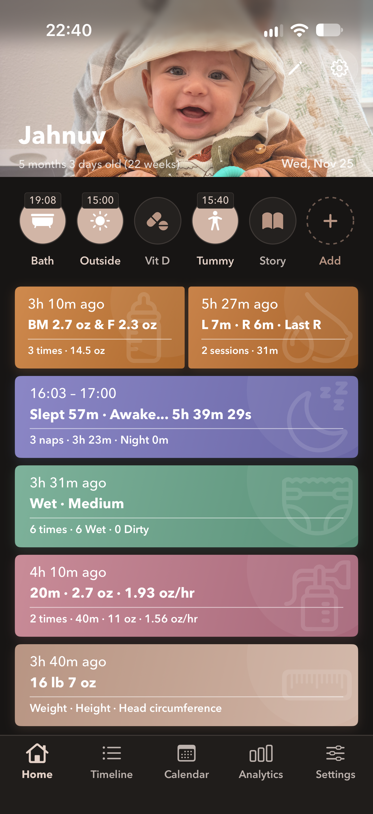
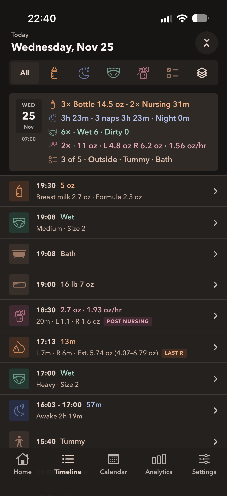
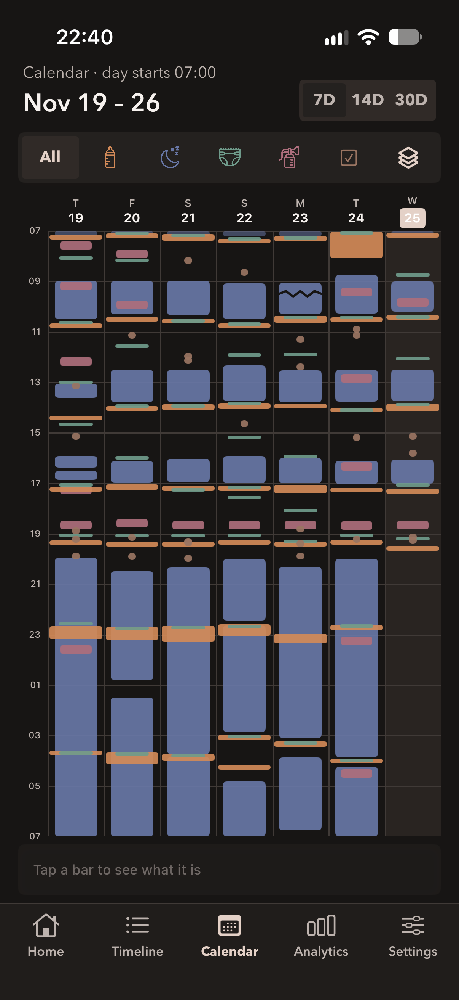
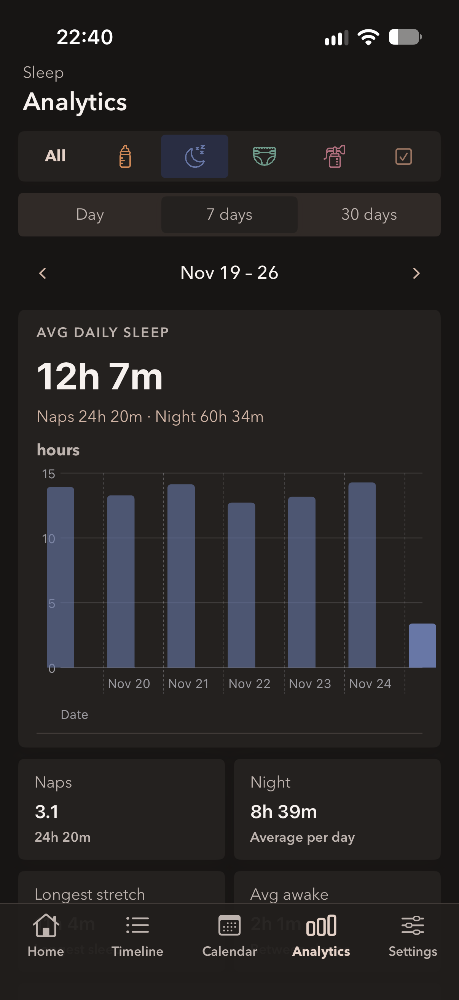

# BabyLog

BabyLog is a personal iOS application built with Swift and SwiftUI to simplify tracking an infant's daily activities. The app was inspired by the need to keep feeding, pumping, diaper changes, and sleep records organized in one place.

## Screenshots

  
  
  
  

Home dashboard · Activity timeline · Calendar · Analytics

## Features

- Breast milk pumping tracking, including volume, duration, and output rate
- Feeding tracking
- Diaper change tracking
- Sleep tracking
- Home dashboard displaying recent activities
- Daily activity timeline and summaries

## Technologies

- Swift
- SwiftUI
- Xcode

## Project Structure

- `BabyLog/` – Application source code and resources
- `BabyLog.xcodeproj` – Xcode project
- `BabyLogTests/` – Unit tests
- `BabyLogUITests/` – UI tests

## Running the App

1. Clone the repository.
2. Open `BabyLog.xcodeproj` in Xcode.
3. Configure any required local Firebase settings and signing credentials.
4. Select an iOS simulator or connected iPhone and build and run the app.

Private documentation, local configuration files, and credentials are excluded from the public repository.
